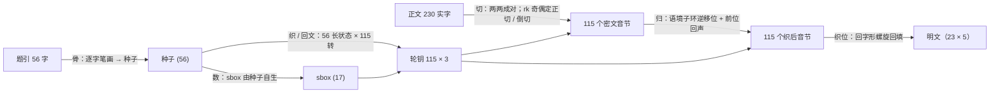

# 叠浪淘沙 · 璇玑秋声 — 破译

> 一份由 AI 生成的四层纯汉字密码挑战卷的完整破译：原始材料、可一键复现的求解程序、逐步题解，以及全部研究与证伪过程。


---

## 结果

> **二〇二三年秋，霜叶如燃，千枫尽赤，一江澄碧，舟楫争流。我们把酒当歌，不亦乐乎。二〇二六年秋，又是一年丰收的时节。美好总是在一瞬间，却很久很久都难以忘怀。今日将这美好镌刻入这方矩阵，千回百转，字里行间，落笔处不过是想让这些绚烂在时间的洪流里留驻得久一点，再久一点。**

115 个音节，与正文 23 行 × 5 对一一对应。依挑战卷指令四，判定以音节序列一致为准，同音字取舍不影响结果。

## 解法

### 流程



| 步骤 | 卷面出处 | 作用 | 来源 |
|---|---|---|---|
| 种子 | 题引字形（"骨"为释读） | 题引 56 字逐字笔画 | 补遗指明，自行计数 |
| 切 | 谁家玉笛**切**霜天 | 230 实字两两成对，按轮钥奇偶取"上声下韵"或"下声上韵" | 卷面识别（z ≈ 6.1）+ 补遗 |
| 数 | 静**数**冰弦骨亦清 | sbox：笔画值按出现次数降序、同次数值升序 | 补遗 |
| 展卷 | 一寸**回文织**未眠 | 56 长状态，每转代换、扩散、轮转，挤出 3 枚轮钥 | 补遗 |
| 归 | 字**归**其位月**归**川 | 在语境子环上三相移位，移位量含前位明文回声 | 补遗 |
| 音节表 | — | GB2312 6763 字默认读音，1194 个合法带调音节 | 自行推得 |
| 织位 | 一寸**回文**织未眠 | 明文逐行写入 23×5 网格，加密顺序为"回"字形螺旋 | 自行推得 |

下面六步即完整解法，参数全部给出，可照此手算或编程复现。更详细的推导、手算表与证据见 [writeup/WRITEUP.md](writeup/WRITEUP.md)。

### 第 1 步　字母表与音节表

- 每个汉字取 `pypinyin` 单字默认读音，记为 **(声母 I, 韵母 F, 声调 T)**，strict 口径：y、w 不作声母（零声母记 `''`），韵母保留介音（`ian`、`iou`、`uei`、`uen`），ü 记 `v`。
- **合法音节表**：GB2312 全部 6763 字的默认读音，去掉空韵母与轻声，共 **1194** 个带调音节。
- 声母表 22 项（字母序，`''` 居首）：`'' b c ch d f g h j k l m n p q r s sh t x z zh`
- 韵母表 36 项：`a ai an ang ao e ei en eng er i ia ian iang iao ie in ing iong iou o ong ou u ua uai uan uang uei uen ueng uo v van ve vn`

### 第 2 步　种子与 sbox（骨 · 数）

种子 = 题引 56 字的规范笔画：

```
万山霜叶下秋烟  3  3 17  5  3  9 10      静数冰弦骨亦清 14 13  6  8  9  6 11
千回锦字未成篇  3  6 13  6  5  6 15      一寸回文织未眠  1  3  6  4  8  5 10
灯深帘底藏雁足  6 11  8  8 17 12  7      凭君验取灯前字  8  7 10  8  6  9  6
谁家玉笛切霜天 10 10  5 11  4 17  4      字归其位月归川  6  5  8  7  4  5  3
```

笔画值 1–17 按"出现次数降序、同次数值升序"排序得 `order = [6,8,3,5,10,4,7,9,11,17,13,1,12,14,15,2,16]`，`sbox[x] = order.index(x+1)`：

```
sbox = [11, 15, 2, 5, 3, 0, 6, 1, 7, 4, 8, 12, 10, 13, 14, 16, 9]
```

### 第 3 步　展卷：115 组轮钥（织 / 回文）

```
S = [(v - 1) % 17 for v in 种子]                         # 长 56
for i in 0..114:
    a[j] = sbox[(S[j] + i) % 17]                          # 代换
    b[j] = (a[j] + a[(j+1)%56] + a[(j+7)%56]) % 17        # 扩散
    r = (b[0] + b[7] + b[8]) % 56;  S = b[r:] + b[:r]     # 轮转
    rk[i] = (S[i%56]+1, S[(7i+8)%56]+1, S[(8i+7)%56]+1)   # 挤出
```

前 5 组：`(12,2,6) (10,6,6) (15,6,16) (9,15,12) (16,1,9)`。

### 第 4 步　切：230 实字 → 115 个密文音节

正文去"兮"与标点得 230 实字，按原文次序连续两两配对（跨句、跨行不断），第 i 对 = (上字, 下字)：

| `rk[i][0]` | 方向 | 密文音节 |
|---|---|---|
| 奇 | 正切 | (上字声母, 下字韵母, 下字声调) |
| 偶 | 倒切 | (下字声母, 上字韵母, 上字声调) |

得正切 66 对、倒切 49 对，115 个音节全部合法。

### 第 5 步　归：语境子环逆移位 + 回声

- **子环**：移位只在能与另两维相拼的子集上进行。声母环 = 能与 (F,T) 相拼的声母，韵母环 = 能与 (I,T) 相拼的韵母（均按字母序），声调环 = (I,F) 实有的声调（升序）。移位 `x' = ring[(ring.index(x) ± k) % len(ring)]`。
- **回声**（取前一位**已还原的明文**音节 (ini, fin, tone)）：回声 I = 韵母表中 fin 的编号，回声 F = tone，回声 T = 声母表中 ini 的编号。首位取 (3, 3, 6)：末字"川"3 画、首字"万"3 画、二者之和。
- **移位量**：`k_I = rk[i][0] + 回声I`，`k_F = rk[i][1] + 回声F`，`k_T = rk[i][2] + 回声T`。
- **三相环序**（解密为加密的逆序，移位取负）：

| i mod 3 | 加密 | 解密 |
|---|---|---|
| 0 | 调 → 韵 → 声 | 声 → 韵 → 调 |
| 1 | 声 → 调 → 韵 | 韵 → 调 → 声 |
| 2 | 韵 → 声 → 调 | 调 → 声 → 韵 |

例：第 0 对"红蕊"，rk[0][0] = 12 为偶 → 倒切得 (r, ong, 2)；k = (15, 5, 12)；声母环 [c,ch,h,l,n,r,t] 上 r → n，韵母环（14 项）上 ong → ian，声调 2 → 2；还原为 **nian2（年）**。

### 第 6 步　织位：回字形螺旋回填

明文按行写入 **23 行 × 5 列**网格（正文 23 行、每行 5 对），加密时沿"回"字形逆时针螺旋取格：从右上角出发，沿最右一列向下，再沿末行向左、首列向上、首行向右，逐圈内收。解密时把第 j 个音节放回螺旋第 j 格，逐行读出：

```
行  螺旋序号               明文音节                                 读法
 1   48  49  50  51   0    er4     ling2   er4     san1    nian2    二〇二三年
 2   47  94  95  52   1    qiu1    shuang1 ye4     ru2     ran2     秋，霜叶如燃
 3   46  93  96  53   2    qian1   feng1   jin3    chi4    yi1      千枫尽赤，一
 4   45  92  97  54   3    jiang1  cheng2  bi4     zhou1   ji2      江澄碧，舟楫
 5   44  91  98  55   4    zheng1  liu2    wo3     men2    ba3      争流。我们把
 6   43  90  99  56   5    jiu3    dang1   ge1     bu4     yi4      酒当歌，不亦
 7   42  89 100  57   6    le4     hu1     er4     ling2   er4      乐乎。二〇二
 8   41  88 101  58   7    liu4    nian2   qiu1    you4    shi4     六年秋，又是
 9   40  87 102  59   8    yi1     nian2   feng1   shou1   de2      一年丰收的
10   39  86 103  60   9    shi2    jie2    mei3    hao3    zong3    时节。美好总
11   38  85 104  61  10    shi4    zai4    yi1     shun4   jian1    是在一瞬间，
12   37  84 105  62  11    que4    hen3    jiu3    hen3    jiu3     却很久很久
13   36  83 106  63  12    dou1    nan2    yi3     wang4   huai2    都难以忘怀。
14   35  82 107  64  13    jin1    ri4     jiang1  zhe4    mei3     今日将这美
15   34  81 108  65  14    hao3    juan1   ke4     ru4     zhe4     好镌刻入这
16   33  80 109  66  15    fang1   ju3     zhen4   qian1   hui2     方矩阵，千回
17   32  79 110  67  16    bai3    zhuan3  zi4     li3     xing2    百转，字里行
18   31  78 111  68  17    jian1   luo4    bi3     chu4    bu4      间，落笔处不
19   30  77 112  69  18    guo4    shi4    xiang3  rang4   zhe4     过是想让这
20   29  76 113  70  19    xie1    xuan4   lan4    zai4    shi2     些绚烂在时
21   28  75 114  71  20    jian1   de2     hong2   liu2    li3      间的洪流里
22   27  74  73  72  21    liu2    zhu4    de2     jiu3    yi1      留驻得久一
23   26  25  24  23  22    dian3   zai4    jiu3    yi1     dian3    点，再久一点。
```

螺旋序号 j 表示该格是加密时第 j 个取出的音节，也就是解密输出的第 j 位。

## 复现

```bash
pip install -r requirements.txt
python3 solution/solve.py
```

程序只读取 `challenge/challenge.txt`，逐步打印自检结果后输出明文（完整输出见 [`solution/expected_output.txt`](solution/expected_output.txt)）：

```
[切]     正切 66 对、倒切 49 对；密文音节合法 115/115；方向唯一确定的 34 对中轮钥吻合 34
[归]     解密完成；重新加密逐位复现 115 个密文音节
[织位]   按 23×5 网格的回字形螺旋回填，逐行读出
[核对]   汉字读法逐字默认读音与明文音节一致 112/115；差异（均为轻声字）……
```

## 仓库结构

```
.
├── README.md                 本页
├── requirements.txt
├── CHANGELOG.md              提交级变更记录
├── challenge/                题目原始材料（卷面、原图、设计者寄语、四处补遗转录、规范哈希）
├── solution/                 独立求解程序 solve.py 与期望输出
├── writeup/
│   ├── WRITEUP.md            逐步题解（算法、参数、演算实例、织位图、验证）
│   ├── REPORT.md             完整分析报告（按时间顺序，含全部假设检验与统计）
│   ├── STORY.md              来龙去脉与时间线
│   └── USAGE.md              各环节 token 与费用记录
├── research/                 探索性实验脚本（20 余族假设、织位搜索、统计检验），见其 README
└── notes/                    分轮工作日志（题目 / 观测 / 证伪 / 规律 / 推导日志 / 变更记录）与验证脚本
```

## 文档索引

| 文档 | 内容 |
|---|---|
| [writeup/WRITEUP.md](writeup/WRITEUP.md) | 题解：每一步的定义、参数表、第 0 轮手算、织位螺旋编号图、明文逐行对照、自检 |
| [writeup/REPORT.md](writeup/REPORT.md) | 分析报告：卷面盲测的 20 项假设族、统计检验、可解性评估、补遗后的解密进展与明文 |
| [writeup/STORY.md](writeup/STORY.md) | 来龙去脉：游戏背景、前一局"大决战"、本卷的出现、交锋与补遗、破译时间线 |
| [writeup/USAGE.md](writeup/USAGE.md) | token 与费用：Claude Code 会话、6 个子 Agent、Gemini 各轮 |
| [challenge/README.md](challenge/README.md) | 原始材料说明与出处 |
| [solution/README.md](solution/README.md) | 求解程序说明 |
| [research/README.md](research/README.md) | 实验脚本目录：每个脚本检验什么、怎么运行、结论 |
| [notes/README.md](notes/README.md) | 工作日志说明（Run 1–8） |

## 关键数据

| 检验 | 结果 |
|---|---|
| 行内相邻反切对（卷面盲测） | 105/115 合法，随机 76 ± 4.8，z ≈ 6.1；错开一位即消失 |
| 轮钥奇偶 vs 方向唯一确定的反切对 | 34/34 吻合，偶然概率约 6 × 10⁻¹¹ |
| 规范实现的唯一性 | 288 种映射 / 符号变体中唯一最优（单字分 −6.29，其余 −8.46 ± 0.23） |
| 两套独立实现 | 音节表、轮钥、密文音节、解密音节逐位一致 |
| 织位识别 | 3875 种网格排列中唯一突出：覆盖 77，随机 2000 次最高 62 |
| 重新加密 | 逐位复现 115 个密文音节 |
| 汉字读法对照 | 112/115 一致，其余 3 处为轻声字（们、的、的）被编码为第二声 |

## 说明

- 文中称挑战卷作者为"命题方"，破译一方为"解题方"，不使用真实姓名。
- 命题方提供的《四处补遗》原件 PDF 含疑似云服务凭证的嵌入数据，已被 GitHub 推送保护拦截，仓库只收录其文字转录（`challenge/supplement.txt`）；命题方与解题方之间的私人往来信件不收录，其要点见 `writeup/REPORT.md` 第 2 节与 `writeup/STORY.md`。
- `research/` 下部分打分脚本需要 jieba 词频表（`dict.txt`），获取方式见 [research/README.md](research/README.md)；`solution/solve.py` 不需要。
