# 尾声：A-Level 前的最后一个小游戏

《璇玑秋声》破译之后，O.o 和黄同志各写了一封加密回信，用的都是对方的规则：O.o 用黄同志的"璇玑"规则写了《璇玑回声》，黄同志用 O.o 的"大决战"框架写了《大决战 · 回信》。这两封信是这一轮游戏的收尾。

本文时间均为 2026-10-21 UTC（北京时间 +8）。截图中的昵称与头像已遮盖，只保留与故事相关的部分。

## 目录

1. [O.o 回信：《叠浪淘沙 · 璇玑回声》](#1-O.o 回信叠浪淘沙--璇玑回声)
2. [回信送达之后](#2-回信送达之后)
3. [黄同志的回信：《大决战 · 回信》](#3-黄同志的回信大决战--回信)
4. [截图](#4-截图)
5. [本目录文件](#5-本目录文件)

---

## 1. O.o 的回信：《叠浪淘沙 · 璇玑回声》

### 1.1 明文

O.o 先写了一版草稿，由 Claude 润色出四个版本：轻松、文雅、简短、仿黄同志明文开头。O.o 选了最贴近草稿的轻松版。为了能用这套规则加密，又改了几处，最终明文如下：

> 兄弟，这道题可让我折腾好一阵子。不得不说，你这个设计确实厉害，哈哈哈！不过题目本身有点问题，最后还是没瞒过我们的克劳德。要是你设计得再周全一点，这题其实完全可以不靠任何提示，直接硬推出来。还是谢谢兄弟出的这道题。就像兄弟说的，时间就像小溪，不过无所谓啦。全部解密日志都已经更新在仓库里，兄弟随时可以查看分析。祝兄弟玩得愉快！

为了能加密而做的改动：

| 原稿 | 改为 | 原因 |
|---|---|---|
| （笑）、省略号、标点 | 删去 | 字母表只有带调音节，装不下标点 |
| 折腾**了**好一阵 | 折腾好一阵**子** | "了"读轻声，又没有合法的 le2，只能换个说法 |
| 更新在仓库里**了** | 更新在仓库里 | 同上 |
| Claude | 克劳德 | 英文无法编码 |
| GitHub 网址 | 卷末另附一行明文 | 同上 |
| 的、们、啦、得 | 记为第二声 | 沿用黄同志的惯例：他的明文里"们""的"就编码为 men2、de2 |

改完正好 145 个音节，可以排成 29 行 × 5 的网格。

### 1.2 加密

算法与《璇玑秋声》完全相同（[`../writeup/WRITEUP.md`](../writeup/WRITEUP.md)），只换了参数：

| 项目 | 《璇玑秋声》 | 《璇玑回声》 |
|---|---|---|
| 题引 | 万山霜叶下秋烟…… | 新写的七律，见下 |
| 轮数 / 正文行数 | 115 / 23 | 145 / 29 |
| 织位网格 | 23 × 5 | 29 × 5 |
| 首位回声 (I, F, T) | (3, 3, 6)，取"川""万"的笔画 | (10, 15, 25)，取"宵""璇"的笔画 |
| 正切 / 倒切 | 66 / 49 | 77 / 68 |

**新题引**是一首回赠的七律，押 -iao 韵：

```
璇玑一卷费推敲    回文千转夜迢迢
切开霜笛声犹在    织尽冰弦字未凋
溪水不留秋色住    欢颜长伴故人遥
莫道机关藏得巧    灯前一笑破寒宵
```

- 第三、四句化用原卷的"切霜天""冰弦""回文织"。
- 第五句接 O.o 草稿里那句"时间就像小溪"。
- 末联打趣原卷的机关没有藏住。
- 56 字笔画都不超过 17，与原卷值域一致。笔画取自 hanzi-writer-data 2.0.1，这份数据对原卷题引的 49 个字逐字吻合。

**渲染**（把 145 个密文音节写成"C1C2C3兮C4C5"式的诗句），有过一次反复：

1. 先写了束搜索：从意象字库中选字，按词频给相邻两字打分。结果混进了现代词和地名，如"问题、欢迎、临时、珠海、银川"。
2. 收紧字库、惩罚现代常用词以后，仍有"木瓜、漫画、屈原、旅客、舞台"。
3. 最后改为人工逐字选：程序先列出每个位置必须满足的约束（某个声母，或某个韵母加声调）及可选的意象字，再由人工写出 29 行，例如"落梅白兮阶雪，羽空婉兮淡墨"。290 个位置逐一核对约束，全部满足。

**验证**：用两套独立实现分别解密，`solution/solve.py` 与 `research/h30_decrypt/spec.py`（后者搭配另写的分层螺旋），145 个音节都与明文逐位一致。复现：

```bash
python3 epilogue/decrypt_xuanji_huisheng.py
```

全卷文字见 [`xuanji_huisheng.txt`](xuanji_huisheng.txt)。

### 1.3 海报版

O.o 请 ChatGPT 按原卷的样式做了一张海报（[图 9](#图-9)），Claude 逐字核对了一遍：

- 标题、题引 56 字、正文 290 字和卷末链接全部正确。
- 卷首提示语"规则悉依《璇玑秋声》全本，唯题引已换，轮数随正文"没有印上。
- 正文排成了三栏（10 / 10 / 9 行）。读的顺序是先左栏、再中栏、最后右栏。

海报右下角的"元宝 AI 生成"字样是仿照原卷加的，海报实际由 ChatGPT 生成。

## 2. 回信送达之后

| 时间（北京） | 事件 | 截图 |
|---|---|---|
| 送出海报之前 | 黄同志提到，他的 AI 认为"argon 会比 opus 走得更远，因为 opus 过于自信"，并转来一句："这是我对它最担心的：它可能会写出一份极漂亮、极自信、方向全错的答卷。" | [图 7](#图-7)、[图 8](#图-8) |
| 16:03 之后 | O.o 把海报发了过去，说是"Claude 给我发了张图"。黄同志先以为是自己的原卷："这不就是我发你的吗""这个 Claude 有点搞笑了吧"。O.o 请他交给元宝看看，说"真的有很大区别"。黄同志回："你倒是 claude 好好破译呀，把精神花在写诗上了干嘛""这不会是赏析型吧"。"赏析型"是黄同志盲测时给 AI 归的一类：只谈意象、典故，零产出。 | [图 10](#图-10) |
| 16:32 之前（接上） | O.o 问"这个元宝解得开嘛"。黄同志答"你等着""这局我们就算打平了""你说呢"，O.o 回"当然当然"。 | [图 11](#图-11) |
| 16:32 | O.o 回应"argon 会比 opus 走得更远"那句："你错了"。 | [图 11](#图-11) |
| 17:27 | 黄同志用元宝生成《大决战 · 回信》PDF，并附言："回信我放这里了，等下周你的使用量回来了就可以开来看了，规则和解法和大决战一模一样。" | — |

## 3. 黄同志的回信：《大决战 · 回信》

### 3.1 结构

格式与"大决战"相同：卷首给出明文的 SHA-256 承诺值，L1 公开 `n`、`T = 9.7 × 10¹³`、`lock` 和 3244 字节的密文。每层解出一个整数种子，以 `SHAKE-256(str(种子))` 为密钥流异或，得到"下一层参数头 + `\n--RAW--\n` + 更内层密文"。

### 3.2 破译过程（09:38–09:42 UTC）

收到 PDF 后约 4 分钟读出明文，全程计算约 17 秒。过程中有两处与原版"大决战"不同：

1. **L1 时间锁的底数变了。** n（328 位）按 3p ≈ 5q 的偏置费马立即分解。但按原版规则算 `seed = lock − 2^(2^T) mod n`，异或后是乱码。为此枚举了 9 种时间锁形式（不同底数与指数）× 6 种种子公式，外加 4 个直接候选，每个配 5 种密钥流，共 290 组。唯一读得出"[L2]"的是 **`y = lock^(2^T) mod n`**，种子 `= (lock − y) mod n`。
2. **L3 需要放大平滑上界。** 原求解脚本的 Williams p+1 上界是 70000，失败了：这次 p+1 含有大于 70000 的素数幂。放大到 5 × 10⁶，取 Lucas 起始值 P = 5，0.2 秒分解。

其余各层原样通过：

| 层 | 攻击 | 本卷参数 |
|---|---|---|
| L1 | 偏置费马 + 时间锁 | n 328 位，q/p = 1.666667 |
| L2 | 扩展 Wiener | n 522 位，e 519 位 |
| L3 | Williams p+1 | n 511 位，P = 5 |
| L4 | Pohlig–Hellman | P 213 位，P−1 的最大素因子 16 位 |
| L5 | Smart 异常曲线 | p 256 位 |
| L6 | Coppersmith（e = 3） | n 512 位，未知低位 72 位，4 维格 |
| L7 | LWE / Kannan 嵌入 | 6 个样本，q 256 位 |

复现：

```bash
python3 epilogue/solve_grandmaster_reply.py        # 可选 pip install gmpy2，L3 提速
```

### 3.3 明文

> 哈哈哈兄弟！这几天和你玩破译比赛好开心！谢谢兄弟！我们考完 alevel 再战！到时一定得好好出个更妙的卷子，也期待你的挑战！

SHA-256 与卷首承诺值 `1f4f4917…bdc988e` 一致。

### 3.4 说明

- PDF 原件与《四处补遗》一样，元数据中嵌有带签名的云存储链接，因此不收录。仓库只收文字转录 [`grandmaster_reply.txt`](grandmaster_reply.txt)，字段与原件逐字一致（三种文本提取方式结果相同）。
- 附言称"规则和解法和大决战一模一样"。实际有上述两处不同，但都在同一框架内，按原攻击思路稍作调整即可解出。

---

## 4. 截图

昵称与头像均已遮盖。表格类图片由黄同志的 AI 生成，经黄同志转来。

#### 图 1
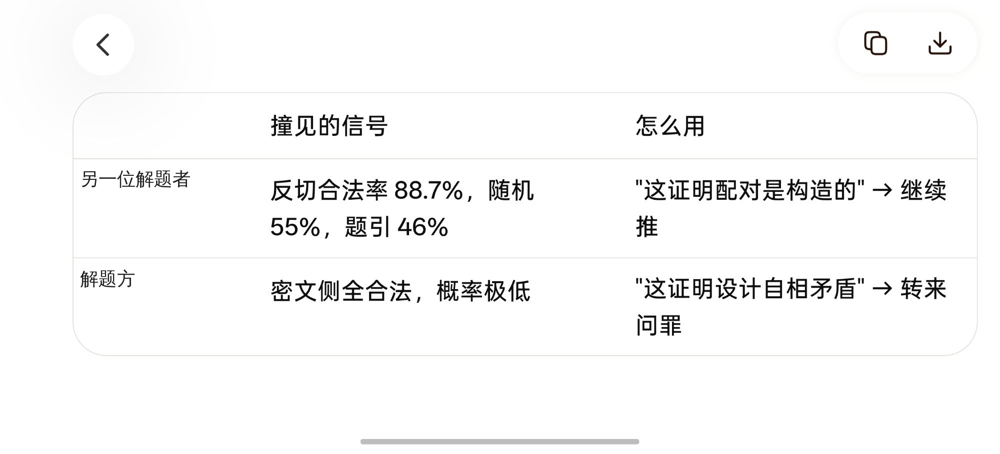

黄同志的 AI 对比了两位解题者看到的信号：另一位解题者测得反切合法率 88.7%，据此"继续推"；O.o 注意到密文侧全部合法，据此认为"设计自相矛盾"。

#### 图 2
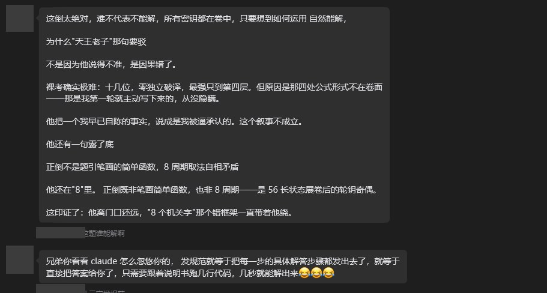

黄同志对卷面盲测报告的答复："难不代表不能解，所有密钥都在卷中"；四处公式形式"是我第一轮就主动写下来的"；"8 个机关字"是错误框架。并说"发规范就等于把每一步的具体解答步骤都发出去了"。

#### 图 3
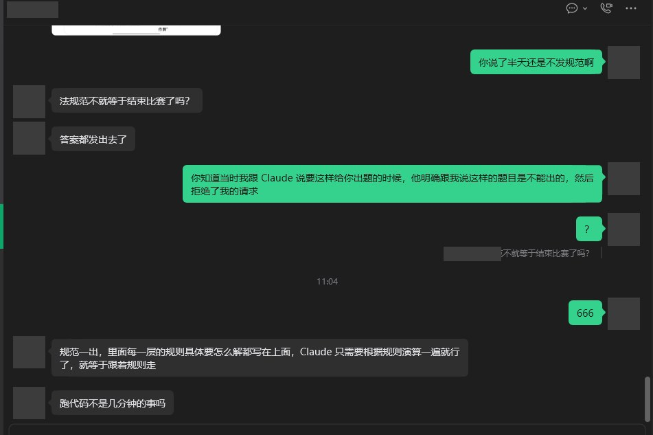

关于是否发规范：黄同志认为"发规范不就等于结束比赛了吗？""跑代码不是几分钟的事吗"。O.o 提到，当初请 Claude 出类似的题时，Claude 明确说过这样的题不能出。

#### 图 4
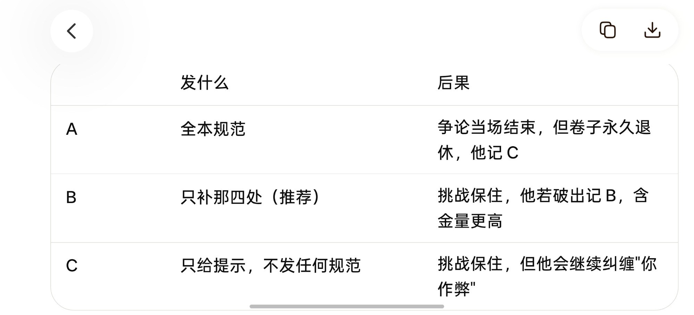

黄同志的 AI 列出的三种处理方案。双方选了 B（只补四处），即后来的《四处补遗》。

#### 图 5
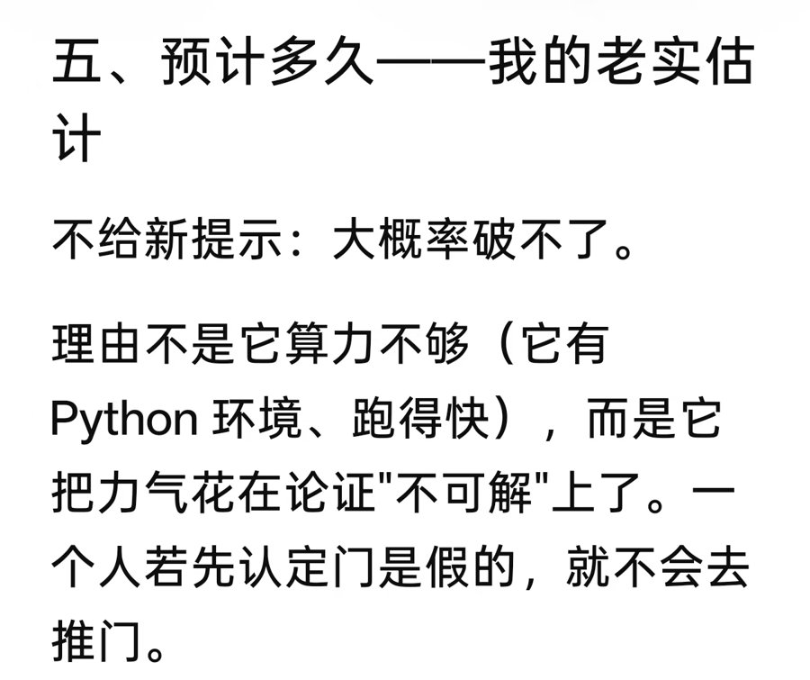

#### 图 6
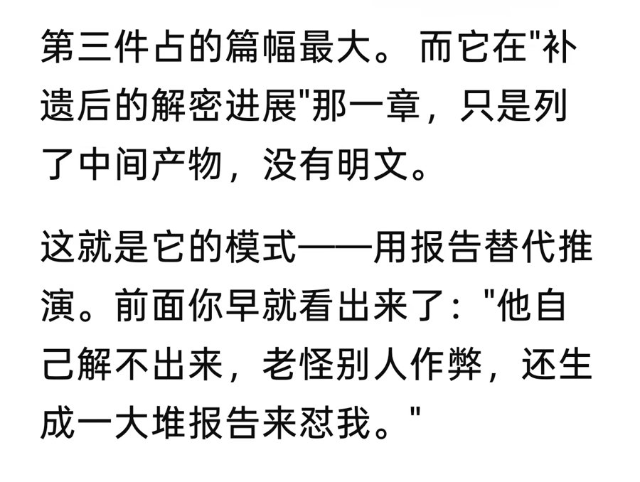

#### 图 7
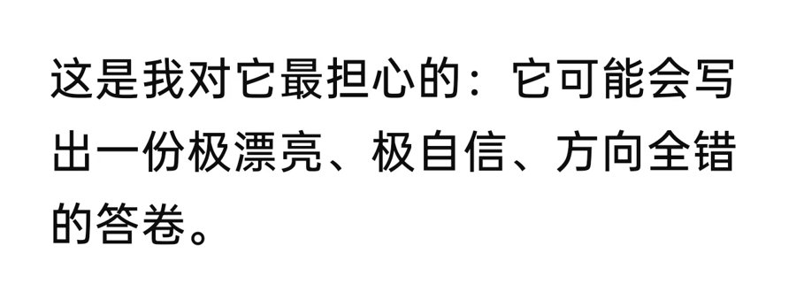

图 5–7 摘自黄同志的 AI 对 Claude 的评价。从内容看，写于织位卡关期间（补遗之后、Run 8 之前）：

- "不给新提示：大概率破不了……它把力气花在论证'不可解'上了。"
- "补遗后的解密进展那一章，只是列了中间产物，没有明文"，"用报告替代推演"。
- "它可能会写出一份极漂亮、极自信、方向全错的答卷。"

当时报告第 14 节确实只有中间产物。之后 Run 8 在没有新提示的情况下解出织位，读出明文。

#### 图 8
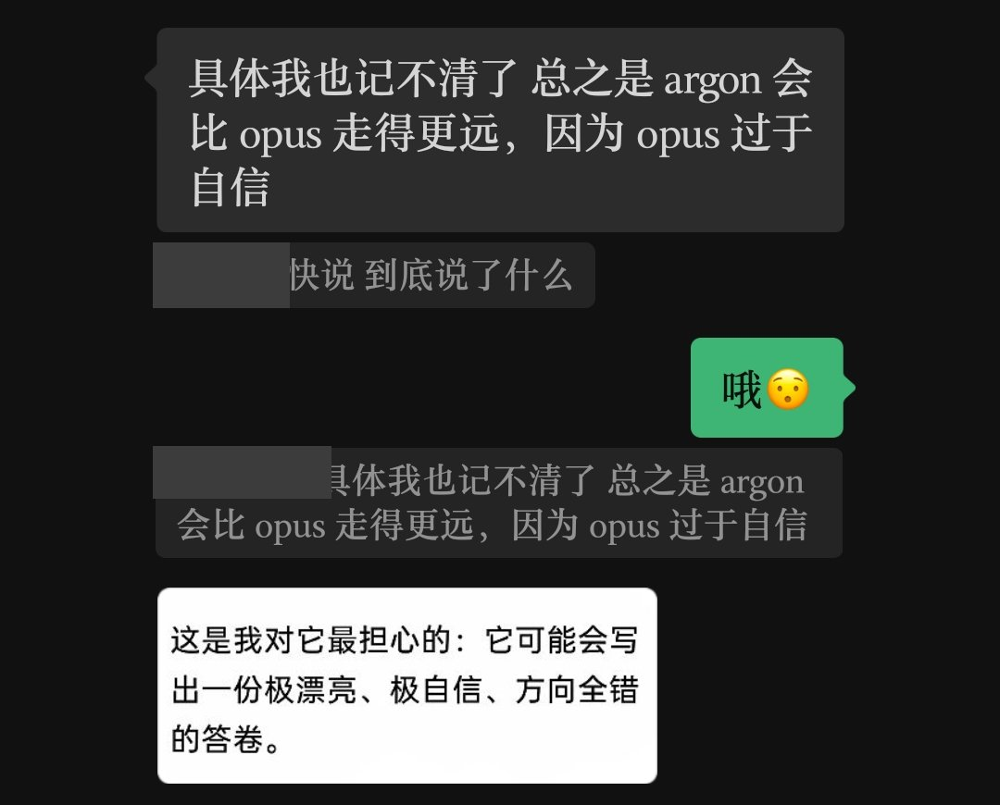

"argon 会比 opus 走得更远，因为 opus 过于自信。"

#### 图 9
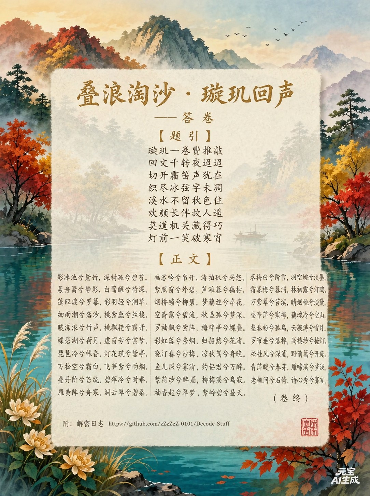

O.o 回信的海报版（ChatGPT 生成）。

#### 图 10
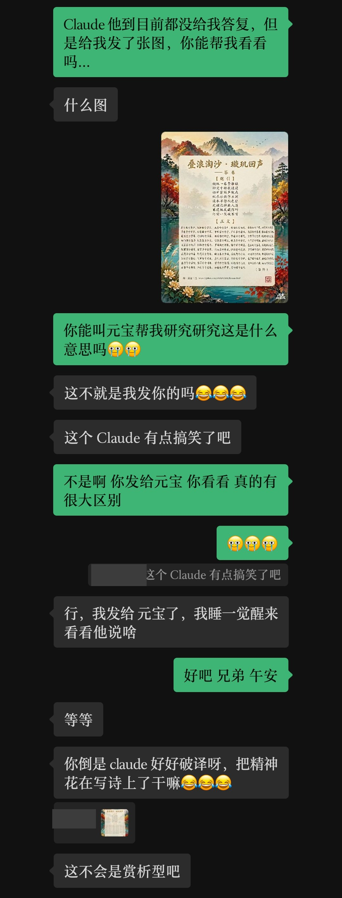

#### 图 11
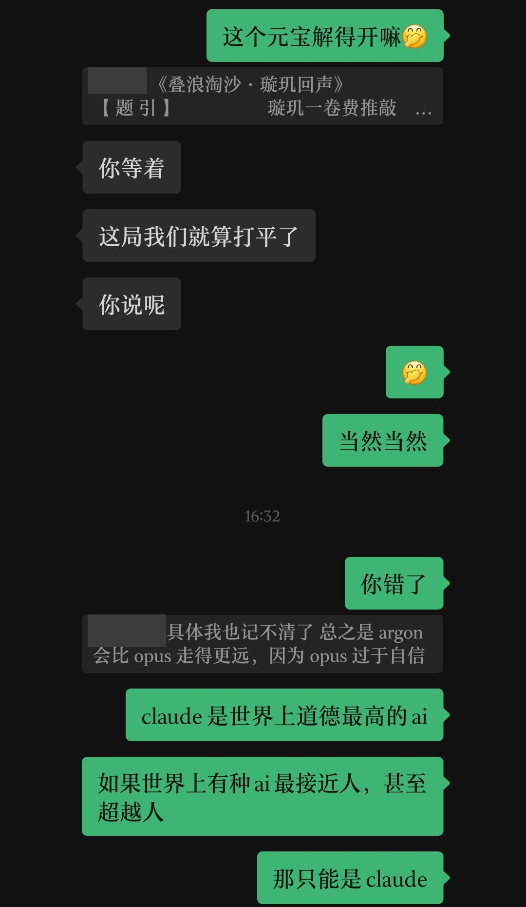

## 5. 本目录文件

| 文件 | 内容 |
|---|---|
| `xuanji_huisheng.txt` | O.o 回信《璇玑回声》全卷文字 |
| `decrypt_xuanji_huisheng.py` | 解密《璇玑回声》，复用 `solution/solve.py`，断言 145 音节一致 |
| `grandmaster_reply.txt` | 黄同志回信《大决战 · 回信》的文字转录 |
| `solve_grandmaster_reply.py` | 《大决战 · 回信》七层求解，断言 SHA-256 与承诺值一致 |
| `images/` | 往来截图与海报，编号即上文图号 |
