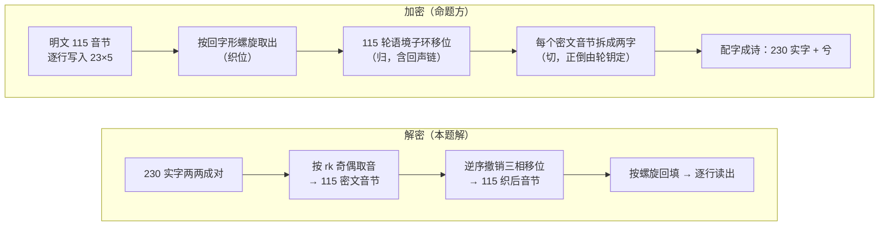

# 题解：《叠浪淘沙 · 璇玑秋声》

本文给出从卷面到明文的完整算法、全部参数、一轮手算实例和验证方法。对应实现为 [`solution/solve.py`](../solution/solve.py)（约 200 行，不依赖其他代码）。算法的四处公式形式来自命题方的《四处补遗》（[`challenge/supplement.txt`](../challenge/supplement.txt)）；种子计数、音节表、织位三项由解题方自行推得。

## 目录

1. [挑战概况](#1-挑战概况)
2. [音节体系与记号](#2-音节体系与记号)
3. [切：反切对与正倒](#3-切反切对与正倒)
4. [展卷：种子、sbox 与轮钥](#4-展卷种子sbox-与轮钥)
5. [归：语境子环、三相环序与回声](#5-归语境子环三相环序与回声)
6. [织位：回字形螺旋](#6-织位回字形螺旋)
7. [明文](#7-明文)
8. [验证](#8-验证)
9. [关键发现与陷阱](#9-关键发现与陷阱)
10. [织位是怎样找到的](#10-织位是怎样找到的)

---

## 1. 挑战概况

- **题引**：七言 8 句，共 56 字。
- **正文**：23 行，每行两个"C1C2C3兮C4C5"分句。去"兮"与标点后得 230 个实字。
- **指令四**：明文是一封现代汉语短简，判定以内容一致为准，不要求字形相同。因此最终比对的是音节序列。



## 2. 音节体系与记号

每个汉字记为三元组 **(声母 I, 韵母 F, 声调 T)**，取 `pypinyin` 单字默认读音、strict 口径：

- y、w 不作声母，零声母记为空串 `''`；
- 韵母保留介音，如 `ian`、`uan`、`iou`、`uei`、`uen`；ü 记为 `v`（`v`、`ve`、`van`、`vn`）；
- 声调取 1–4。

**合法音节表**取 GB2312 全部 6763 字的默认读音，去掉空韵母（如"嗯 n2"）与轻声，共 **1194** 个带调音节。由此得到：

| 表 | 项数 | 内容（字母序，编号自 0 起） |
|---|---|---|
| 声母表 | 22 | `'' b c ch d f g h j k l m n p q r s sh t x z zh` |
| 韵母表 | 36 | `a ai an ang ao e ei en eng er i ia ian iang iao ie in ing iong iou o ong ou u ua uai uan uang uei uen ueng uo v van ve vn` |
| 声调表 | 4 | `1 2 3 4` |

这一口径是唯一能让解密输出接近真实汉语的口径。零声母改排末尾、收入空韵母、改用多音字全读音、改用全部 CJK 字，输出都会退回随机水平（详见 [REPORT.md 第 14 节](REPORT.md#14-补遗后的解密进展)）。

## 3. 切：反切对与正倒

230 实字按原文次序连续两两配对，跨句、跨行不断，得 115 对：第 i 对 = (`real[2i]`, `real[2i+1]`)。

| 方向 | 条件 | 取音 |
|---|---|---|
| 正切 | `rk[i][0]` 为奇 | (上字声母, 下字韵母, 下字声调) |
| 倒切 | `rk[i][0]` 为偶 | (下字声母, 上字韵母, 上字声调) |

结果为正切 66 对、倒切 49 对，115 个密文音节全部合法。

**这一层在卷面上可以识别。** 补遗之前，单向正切已有 105/115 合法（S21 口径），随机打乱后为 76 ± 4.8，z ≈ 6.1；错开一位后信号消失。

**轮钥的检验。** 115 对中有 34 对只有一个方向能拼出合法音节（21 对只能正切，13 对只能倒切）。由轮钥奇偶决定的方向在这 34 对上全部吻合，偶然吻合的概率约 2⁻³⁴ ≈ 6 × 10⁻¹¹。这同时验证了种子、sbox 约定和整个展卷过程。

## 4. 展卷：种子、sbox 与轮钥

### 4.1 种子

种子为题引 56 字的规范笔画，取值 1–17：

```
万山霜叶下秋烟  3  3 17  5  3  9 10
千回锦字未成篇  3  6 13  6  5  6 15
灯深帘底藏雁足  6 11  8  8 17 12  7
谁家玉笛切霜天 10 10  5 11  4 17  4
静数冰弦骨亦清 14 13  6  8  9  6 11
一寸回文织未眠  1  3  6  4  8  5 10
凭君验取灯前字  8  7 10  8  6  9  6
字归其位月归川  6  5  8  7  4  5  3
```

### 4.2 sbox（数）

各笔画值在种子中的出现次数：

| 值 | 1 | 2 | 3 | 4 | 5 | 6 | 7 | 8 | 9 | 10 | 11 | 12 | 13 | 14 | 15 | 16 | 17 |
|---|---|---|---|---|---|---|---|---|---|---|---|---|---|---|---|---|---|
| 次数 | 1 | 0 | 6 | 4 | 6 | 10 | 3 | 7 | 3 | 5 | 3 | 1 | 2 | 1 | 1 | 0 | 3 |

按"次数降序、同次数值升序"排列得 `order = [6, 8, 3, 5, 10, 4, 7, 9, 11, 17, 13, 1, 12, 14, 15, 2, 16]`。sbox 的参数 x ∈ 0..16 与状态同空间（x 对应笔画值 x + 1），`sbox[x] = order.index(x + 1)`：

```
sbox = [11, 15, 2, 5, 3, 0, 6, 1, 7, 4, 8, 12, 10, 13, 14, 16, 9]
```

补遗称约定有 4 种可试。另外 3 种（`(-cnt,-v)`、`(cnt,v)`、`(cnt,-v)`）分别只得 96、99、96 个合法密文音节，立即排除。

### 4.3 状态与轮钥（织 / 回文）

初始状态 `S = [(v − 1) mod 17 for v in 种子]`，长度 56，全程不变。第 i 转（i = 0..114）依次执行：

```
代换  a[j] = sbox[(S[j] + i) mod 17]
扩散  b[j] = (a[j] + a[j+1] + a[j+7]) mod 17          # 下标模 56
轮转  r = (b[0] + b[7] + b[8]) mod 56；S = b[r:] + b[:r]
挤出  rk[i] = (S[i mod 56] + 1, S[(7i+8) mod 56] + 1, S[(8i+7) mod 56] + 1)
```

前 5 转的轮钥：`(12,2,6) (10,6,6) (15,6,16) (9,15,12) (16,1,9)`。

## 5. 归：语境子环、三相环序与回声

### 5.1 语境子环

移位只在"能与另两维相拼"的子集上进行，模数为子环长度：

- 声母子环 `ini_ring(F, T)`：能与 (F, T) 相拼的声母，按字母序；
- 韵母子环 `fin_ring(I, T)`：能与 (I, T) 相拼的韵母，按字母序；
- 声调子环 `tone_ring(I, F)`：(I, F) 实际存在的声调，升序。

移位：`x' = ring[(ring.index(x) + k) mod len(ring)]`。子环天然保证每一步都是合法音节。

### 5.2 三相环序

| i mod 3 | 加密顺序 | 解密顺序 |
|---|---|---|
| 0 | 调 → 韵 → 声 | 声 → 韵 → 调 |
| 1 | 声 → 调 → 韵 | 韵 → 调 → 声 |
| 2 | 韵 → 声 → 调 | 调 → 声 → 韵 |

### 5.3 回声与移位量

设前位已还原的明文音节为 (ini_, fin_, tone_)，则：

- 回声 I = 韵母表中 fin_ 的编号；
- 回声 F = tone_ 的取值（1–4）；
- 回声 T = 声母表中 ini_ 的编号。

首位（i = 0）没有前位，取题引末字"川"的笔画 3 作回声 I，首字"万"的笔画 3 作回声 F，二者之和 6 作回声 T。

移位量为 `k_I = rk[i][0] + 回声 I`、`k_F = rk[i][1] + 回声 F`、`k_T = rk[i][2] + 回声 T`。解密时逆序施行，并减去移位量。

### 5.4 第 0 轮手算

| 步骤 | 内容 | 结果 |
|---|---|---|
| 配对 | 第 0 对 = 红（hong2）、蕊（rui3） | — |
| 正倒 | rk[0][0] = 12，偶 → 倒切：(蕊的声母, 红的韵母, 红的声调) | 密文 (r, ong, 2) |
| 移位量 | k_I = 12 + 3 = 15，k_F = 2 + 3 = 5，k_T = 6 + 6 = 12 | — |
| 撤销声母 | ini_ring(ong, 2) = [c, ch, h, l, n, r, t]；r 的位置 5 → (5 − 15) mod 7 = 4 | n |
| 撤销韵母 | fin_ring(n, 2) = [a, an, ang, ao, eng, i, ian, iang, in, ing, iou, ong, u, uo]；ong 的位置 11 → (11 − 5) mod 14 = 6 | ian |
| 撤销声调 | tone_ring(n, ian) = [1, 2, 3, 4]；2 的位置 1 → (1 − 12) mod 4 = 1 | 2 |
| 结果 | 第 0 轮明文音节 | **nian2**（年） |

"年"是明文网格第 0 行第 4 列，正是织位螺旋的起点（见第 6 节）。

## 6. 织位：回字形螺旋

明文 115 个音节**按行**写入 23 行 × 5 列网格（正文 23 行、每行 5 对）。加密顺序沿"回"字形逆时针螺旋取格：从右上角出发，沿最右一列向下，再沿末行向左、首列向上、首行向右，逐圈内收。下图为每格在加密顺序中的轮次 j：

```
 48  49  50  51   0
 47  94  95  52   1
 46  93  96  53   2
 45  92  97  54   3
 44  91  98  55   4
 43  90  99  56   5
 42  89 100  57   6
 41  88 101  58   7
 40  87 102  59   8
 39  86 103  60   9
 38  85 104  61  10
 37  84 105  62  11
 36  83 106  63  12
 35  82 107  64  13
 34  81 108  65  14
 33  80 109  66  15
 32  79 110  67  16
 31  78 111  68  17
 30  77 112  69  18
 29  76 113  70  19
 28  75 114  71  20
 27  74  73  72  21
 26  25  24  23  22
```

解密得到的第 j 个音节放回编号为 j 的格子，再逐行读出，即为明文。

## 7. 明文

| 行 | 音节 | 读法 |
|---|---|---|
| 1 | er4 ling2 er4 san1 nian2 | 二〇二三年 |
| 2 | qiu1 shuang1 ye4 ru2 ran2 | 秋，霜叶如燃 |
| 3 | qian1 feng1 jin3 chi4 yi1 | 千枫尽赤，一 |
| 4 | jiang1 cheng2 bi4 zhou1 ji2 | 江澄碧，舟楫 |
| 5 | zheng1 liu2 wo3 men2 ba3 | 争流。我们把 |
| 6 | jiu3 dang1 ge1 bu4 yi4 | 酒当歌，不亦 |
| 7 | le4 hu1 er4 ling2 er4 | 乐乎。二〇二 |
| 8 | liu4 nian2 qiu1 you4 shi4 | 六年秋，又是 |
| 9 | yi1 nian2 feng1 shou1 de2 | 一年丰收的 |
| 10 | shi2 jie2 mei3 hao3 zong3 | 时节。美好总 |
| 11 | shi4 zai4 yi1 shun4 jian1 | 是在一瞬间， |
| 12 | que4 hen3 jiu3 hen3 jiu3 | 却很久很久 |
| 13 | dou1 nan2 yi3 wang4 huai2 | 都难以忘怀。 |
| 14 | jin1 ri4 jiang1 zhe4 mei3 | 今日将这美 |
| 15 | hao3 juan1 ke4 ru4 zhe4 | 好镌刻入这 |
| 16 | fang1 ju3 zhen4 qian1 hui2 | 方矩阵，千回 |
| 17 | bai3 zhuan3 zi4 li3 xing2 | 百转，字里行 |
| 18 | jian1 luo4 bi3 chu4 bu4 | 间，落笔处不 |
| 19 | guo4 shi4 xiang3 rang4 zhe4 | 过是想让这 |
| 20 | xie1 xuan4 lan4 zai4 shi2 | 些绚烂在时 |
| 21 | jian1 de2 hong2 liu2 li3 | 间的洪流里 |
| 22 | liu2 zhu4 de2 jiu3 yi1 | 留驻得久一 |
| 23 | dian3 zai4 jiu3 yi1 dian3 | 点，再久一点。 |

> 二〇二三年秋，霜叶如燃，千枫尽赤，一江澄碧，舟楫争流。我们把酒当歌，不亦乐乎。二〇二六年秋，又是一年丰收的时节。美好总是在一瞬间，却很久很久都难以忘怀。今日将这美好镌刻入这方矩阵，千回百转，字里行间，落笔处不过是想让这些绚烂在时间的洪流里留驻得久一点，再久一点。

开头的意象与《沁园春·长沙》"万山红遍，层林尽染；漫江碧透，百舸争流"相呼应，题引首句"万山霜叶下秋烟"亦同源；"镌刻入这方矩阵""千回百转"呼应织位网格与螺旋。

## 8. 验证

`python3 solution/solve.py` 依次断言并打印：

1. **卷面解析**：题引 8 句 × 7 字，正文 23 行，230 实字。
2. **正倒与合法性**：115/115 密文音节合法；方向唯一确定的 34 对与轮钥奇偶全部吻合。
3. **可逆性**：用同一轮钥与回声链把解出的音节重新加密，逐位复现 115 个密文音节。
4. **读法对照**：上表汉字逐字取默认读音，与明文音节 112/115 一致；其余 3 处是轻声字（第 23 位"们"、第 44 位和第 101 位"的"），命题方编码时记为第二声（men2、de2），因为字母表只有 1–4 声。

另有两项独立证据：

- 另一份独立实现（[`research/decode.py`](../research/decode.py)）得到的音节表、轮钥、密文音节和解密音节与本实现逐位一致。
- 在 288 种"轮钥分量对应 × 回声对应 × 正负号"变体中，只有规范口径的解密输出接近真实汉语（单字分 −6.29），其余全部在随机水平（−8.46 ± 0.23）。

## 9. 关键发现与陷阱

| 主题 | 说明 |
|---|---|
| 回声链自同步 | 回声只取前一位明文，且许多子环很短（长度 1 时 mod 1 = 0，误差被吸收）。首位回声取错时，约 9 位后有 83% 的概率回到正解。命题方所称"错一格即全篇崩坏"对该装置不成立。 |
| 轻声的编码 | 字母表只有 1–4 声，明文中的"们""的"被编码为第二声。 |
| 多音字列表的陷阱 | `pinyin(c, style=INITIALS, heteronym=True)` 会丢掉零声母的空串，导致"涌、野、月、檐"被误取为 ch / sh / r / d 声母。必须取默认读音。 |
| `get_finals('lv')` | 返回空串，需先把 v 换成 ü；`to_finals('lv4', strict=True)` 无此问题。 |
| 打分器的校准 | 词库须同时收录词组读音与逐字默认读音；任何"可读性"信号都必须与同一组音节的随机排列对照（同等候选数下取最大值），否则在 55–60 分区间会被噪声淹没。 |
| 编造的中间结论 | 某轮 AI 笔记中出现过与卷面不符的"题引"和无计算依据的"明文"，均已在 `notes/` 中更正并注明。 |

## 10. 织位是怎样找到的

1. **音节已知正确**：解密输出的音节频率接近真实汉语，而任何规范变体或音节表改动都会退回随机水平；不受约束的重排可达覆盖 99（真实短文 86，随机合法音节 54）。问题因此集中在顺序上。
2. **排除固定间距类排列**：在真实短文上验证，"按距离统计相邻词对"能可靠地发现织乱后的固定间距（按列织乱后峰值准确出现，z = 6.5）。解密序列在所有距离上最高仅 z = 2.5，说明织位不是单一固定间距的规则排列。
3. **逐族排除**：倒序、交错、对折、栅栏、各宽度网格的行 / 列 / 蛇形 / 螺旋 / 斜扫、约瑟夫环、按轮钥排序、完美洗牌重复 1–1200 次、块内置换等，累计数千种，均与随机无异。
4. **通用枚举命中**：把"写入路径 × 读出路径"在所有 115–130 格的网格上全部组合（3875 种不同排列）。**"23×5 按行写入、回字形螺旋读出"** 覆盖 77，第二名 64，随机 2000 次最高 62。此前的螺旋族第一步总是沿行方向，而且明文总按同一网格行优先写入，恰好漏掉了这一组合。

各族的完整数据见 [`notes/failed_attempts.md`](../notes/failed_attempts.md) 与 [`research/README.md`](../research/README.md)。
